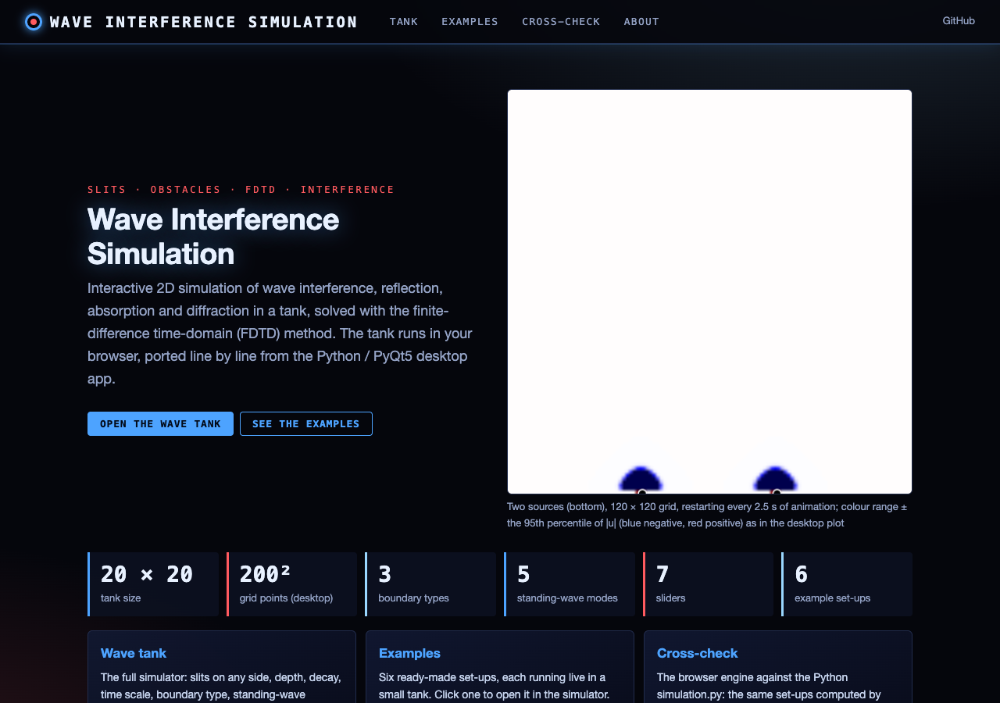
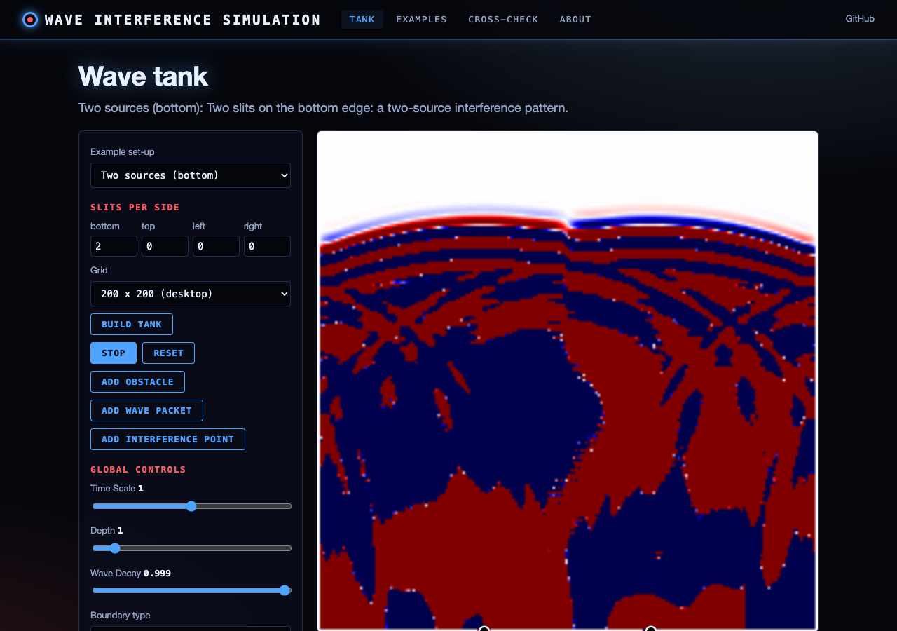
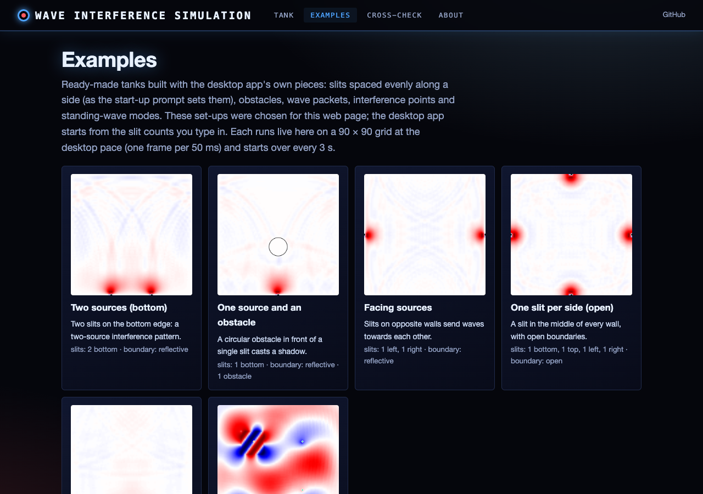
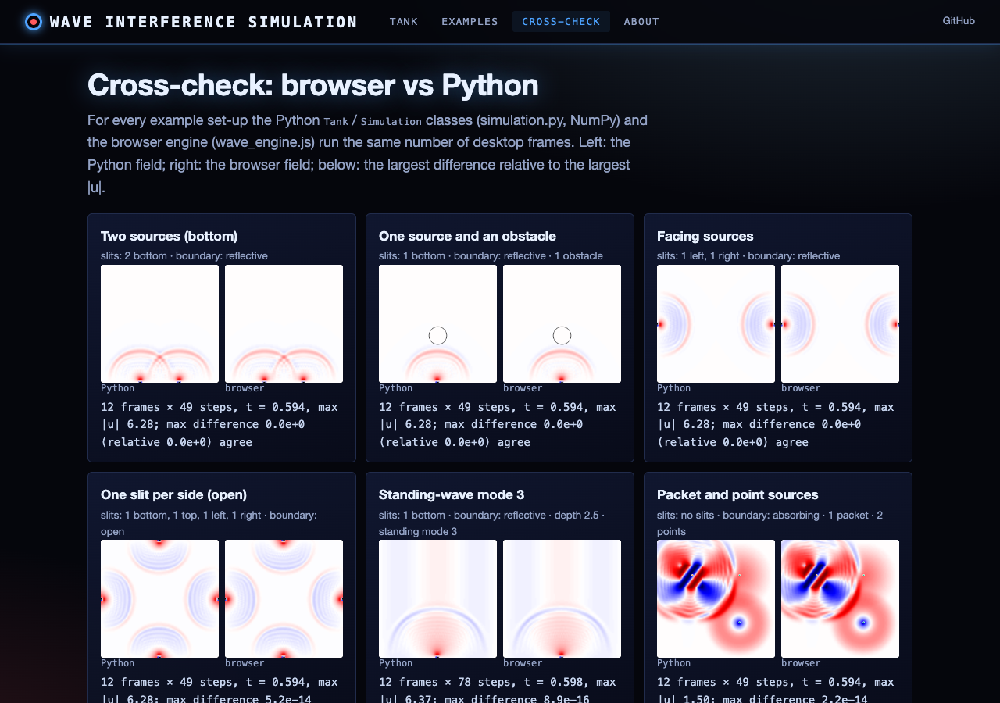

# Wave Interference Simulation

## Overview

This project is an interactive simulation of wave phenomena, focusing on interference patterns in a 2D environment. It provides a visual representation of various wave behaviors, including reflection, absorption, diffraction, and interference. The simulation is built using Python and PyQt5 for the graphical user interface, with matplotlib for rendering the wave field.

## Features

- Real-time simulation of wave propagation and interference
- Multiple wave sources (slits) with adjustable properties
- Various boundary conditions: reflective, absorbing, and open
- Addition of obstacles to observe diffraction and reflection
- Generation of wave packets and interference points
- Standing wave mode visualization
- Adjustable global parameters: time scale, depth, and decay factor

## Installation

1. Clone this repository:
git clone https://github.com/gddickinson/interference_simulation.git

2. Install the required dependencies:
pip install numpy matplotlib PyQt5

3. Run the simulation:
python main.py

## Usage Instructions

1. **Starting the Simulation**: Upon launching, you'll be prompted to enter the number of slits for each side of the tank. After setup, click the "Start" button to begin the simulation.

2. **Adjusting Global Parameters**:
- The "Time Scale" slider scales the clock that drives the sources (time += dt × scale), so sources oscillate
  faster or slower relative to the waves; wave propagation per step is unchanged.
- The "Depth" slider adjusts the simulated water depth, affecting wave speed.
- "Wave Decay" controls how quickly waves dissipate over distance.

3. **Boundary Conditions**: Select between "Reflective", "Absorbing", or "Open" boundaries using the dropdown menu.

4. **Slit Controls**: Each slit has individual controls for amplitude, wavelength, frequency, and width.

5. **Adding Elements**:
- Click "Add Obstacle" to place a random circular obstacle in the tank.
- "Add Wave Packet" adds a Gaussian-weighted travelling-wave source at a random position (it keeps driving the tank).
- "Add Interference Point" places a point source of waves.

6. **Standing Waves**: Select a standing wave mode from the dropdown to visualize different harmonic patterns.

7. **Reset**: The "Reset" button clears all waves, wave packets, interference points and the standing-wave mode;
   obstacles stay in the tank.

## Mathematical Background

The simulation is based on the 2D wave equation:

∂²u/∂t² = c²(∂²u/∂x² + ∂²u/∂y²)

Where:
- u is the wave amplitude
- t is time
- c is the wave speed
- x and y are spatial coordinates

We use the Finite-Difference Time-Domain (FDTD) method to numerically solve this equation. The discretized update equation is:

u(t+Δt) = 2u(t) - u(t-Δt) + c²Δt²(∂²u/∂x² + ∂²u/∂y²)

Key aspects of the simulation:

1. **Wave Speed**: c = 10·√h, where h is the depth (a √(gh)-like shallow-water scaling). The time step is
   Δt = 0.05·Δx/c, so a deeper tank takes more steps per frame.
2. **Boundary Conditions**:
- Reflective: u = 0 at boundaries
- Absorbing: Gradual dampening near edges
- Open: transparent walls with the first-order Mur (Engquist-Majda) absorbing boundary condition; a pulse
  leaving the tank sends back well under 1 % of its energy
3. **Wave Sources**: slits are prescribed (hard) sources, like the dipper of a ripple tank: every step the cells of
   the opening are set to A·sin(2π(f t − d/λ)), where d is the distance from the wall into the tank (all slits on
   a wall are fed by the same plane wave, so they are in phase), with adjustable amplitude, frequency, wavelength
   and width. The
   field therefore stays of the order of A, and the plot's colour range is ± the largest source amplitude.
4. **Obstacles**: Implemented as regions where u = 0.
5. **Wave Packets**: a sinusoid travelling along a direction, prescribed on the packet's centre line and blended
   into the field with a Gaussian weight. Interference points hold one grid point at A·sin(2π f t).
6. **Standing Waves**: the mode shape 0.5·sin(mπx/W)·sin(2πt) is superposed on the displayed field, creating
   nodes and antinodes along x.

## Web version

The simulation also runs in the browser: **https://gddickinson.github.io/interference_simulation/** (static site,
published from `main` by `.github/workflows/pages.yml`). `web/static/wave_engine.js` is a line-by-line JavaScript port
of `simulation.py`; a node test checks it against fields computed by the Python code
(`tests/fixtures/wave_reference.json`), and the Cross-check page compares both live.

Pages: **Tank** (every desktop control plus the slit-count prompt, example set-ups, grid size, automatic colour range,
click to place obstacles/sources, PNG export), **Examples**, **Cross-check** (Python vs browser) and **About**.

### Run the web app

```
pip install -r requirements-web.txt
python run_web.py            # http://127.0.0.1:8230
python -m pytest -q tests    # simulation + web tests (node 18+ for the engine test)
python scripts/build_static.py   # static site in site/
```

| Home | Tank |
|---|---|
|  |  |
| **Examples** | **Cross-check** |
|  |  |

## Contributing

Contributions to improve the simulation or add new features are welcome. Please fork the repository and submit a pull request with your changes.

## License

This project is licensed under the MIT License - see the [LICENSE](LICENSE) file for details.

## Acknowledgments

- This simulation was inspired by various wave optics and fluid dynamics principles.
- Special thanks to the PyQt5 and matplotlib commun
